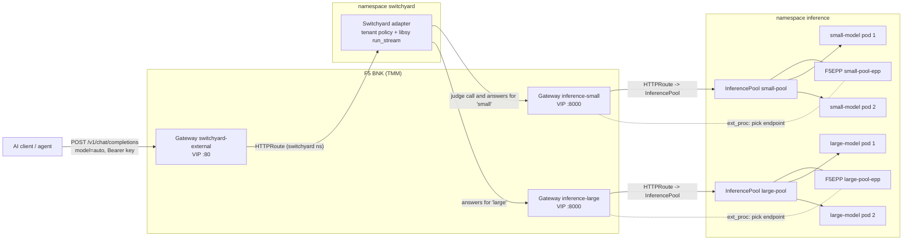
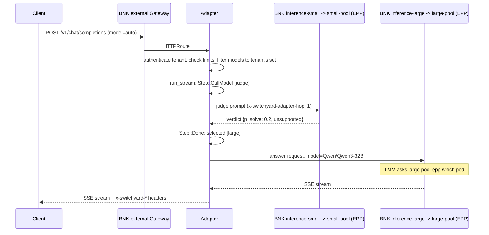

# bnk-switchyard-adapter

Task-aware model selection with NVIDIA NeMo Switchyard, then GPU-aware endpoint selection with
F5 BIG-IP Next for Kubernetes (BNK). Switchyard decides which model should answer a request.
BNK's F5 Endpoint Picker (EPP) decides which replica of that model serves it.

This is a proof of concept. Everything below says whether it was tested here, against mocks,
or still needs a BNK cluster.

## The use case

A platform team runs agents for two internal groups on one BNK cluster. The engineering
group runs coding agents. The support group runs a customer-support bot. The cluster has two
model pools: a small model on one GPU and a large model on four.

An agent task is a chain of steps, and most steps are easy. Read a file, format a tool
call, write a commit message. One or two steps per task are hard: plan the fix, find the
race condition. Teams today pick one model for the whole chain. Pin the large model and
every "format this as JSON" step waits in the same queue as the hard work, on the most
expensive GPUs. Pin the small model and the hard steps fail.

Switchyard fixes the model choice per step. That still leaves two questions BNK answers:

1. Which replica of the chosen model should take the request? The F5 EPP scores each pod
   on queue depth, running requests, KV-cache use and prompt-prefix affinity, per request.
2. Who may use which model? The support bot has a small budget and may never use the large
   model, whatever Switchyard thinks. That rule lives outside the routing algorithm, so a
   classifier mistake cannot spend frontier GPU time for a tenant that isn't allowed it.

Right model, right GPU, right tenant.

### How this differs from the Kong integration

Kong AI Gateway ships an
[NVIDIA Switchyard routing policy](https://developer.konghq.com/ai-gateway/policies/ai-routing-provider/).
It asks a remote Switchyard Decision API which model to use, by default redacting the
messages before the decision request leaves the gateway, and then dispatches to a configured
AI Model entity. That fits a gateway in front of hosted providers.

This adapter runs Switchyard's `libsy` in-process, inside the cluster, next to the GPUs. The
classifier sees the real prompt and no prompt leaves the cluster. The judge model is itself
served by a BNK pool, so its calls are load-balanced by the EPP like any other request. The
answer then goes to an InferencePool, where the EPP picks the GPU replica. Kong's policy page
describes model selection only; endpoint selection inside a model deployment is the part BNK
adds here.

Behind BNK's own AI gateway (Polaris) the shape matches Kong's: the gateway owns keys, scopes and
budgets and asks Switchyard for the model. What this repository adds past that point, all
verified on a BNK 2.4.2 lab:

| | Kong AI Gateway + Switchyard | BNK AI gateway + Switchyard (this repository) |
|---|---|---|
| Which model | Switchyard decision service | Switchyard over ext_proc, in the gateway's model-router slot |
| Which replica of that model | not covered | F5's endpoint picker, per request, from queue and KV-cache metrics |
| Self-hosted engines | not covered | vLLM-compatible pools and NVIDIA Dynamo (the picker reads Dynamo's KV events on NATS) |
| Scope after the router decides | not shown | the gateway checks the key's scope on the model Switchyard chose (a key outside it gets 403) |
| Cost per completed task vs threshold | reported (43.7% lower at threshold 0.5 vs 0.3) | measured by the learner in the lab: `polaris_bench.py --sweep` |

## Architecture



One request on the `auto` route:



## How a logical model reaches the right pool

A model name on its own selects nothing in Gateway API. The pool is chosen by which
HTTPRoute matches. The chain is explicit and written in config:

1. The client sends `model: auto` (a route) or `model: small` (a logical model).
2. The adapter runs the route's Switchyard algorithm over the tenant's permitted models and
   gets a logical model, say `large`.
3. The registry entry for `large` holds `provider_model = "Qwen/Qwen3-32B"` and
   `base_url = "http://172.16.201.112:8000/v1"`, the VIP of Gateway `inference-large`.
4. That Gateway has exactly one HTTPRoute, whose only backendRef is
   `InferencePool inference/large-pool`.
5. `large-pool` selects only `app: large-model` pods and names `large-pool-epp`. TMM asks
   that EPP for an endpoint on every request.

So a request routed to `large` cannot land on a small-model pod: the pool selector doesn't
include them. The served model name also equals the F5EPP `tokenizer.name`, which the EPP
needs for prefix-cache scoring.

An optional overlay puts one Gateway in front of both pools and selects the pool by the
`x-switchyard-pool` header instead. It is
[not verified on BNK yet](docs/FEASIBILITY.md#can-bnk-do-what-the-design-needs).

## Behind BNK's AI gateway (Polaris), with the pool bridge

With Polaris as the front door, the adapter does two jobs and serves no chat API
(`deploy/instruqt/adapter.toml`):

1. **Model router** (ext_proc, port 50051). Polaris's profile calls it for each request through
   the semantic-router slot. Switchyard decides; the answer rewrites `model` to a Polaris AIModel
   (`sy-small`, `sy-large`).
2. **Pool bridge** (HTTP, port 8000). Those AIModels' providers point at
   `http://switchyard-router.<ns>:8000/pools/<pool>/v1`. For each request the bridge asks the
   pool's endpoint picker (the F5 EPP, gRPC ext_proc on 9002, the same exchange TMM uses) which pod
   should serve it, and forwards the request there.

The bridge exists because in BNK 2.4.2 a Polaris provider is a URL and cannot name an
InferencePool, and a provider URL that is a BNK Gateway VIP is reset. If the picker does not
answer within `pick_timeout_ms` or the chosen pod is gone, the bridge fails open to the pool's
Service, as `failureMode: FailOpen` says. Every response carries `x-pool-pick` (`epp`,
`fail-open`, `epp-refused`) and `x-pool-endpoint`; the counters are `sy_adapter_pool_bridge_*`.

The bridge plays the gateway's part of the endpoint-picker contract in full:

- **The picker's request mutations.** Every header the picker sets reaches the pod, and a body it
  replaces is forwarded instead. NVIDIA Dynamo needs this: its worker's frontend sidecar, in
  direct mode, serves the worker the picker names in `x-dynamo-worker-instance-id`. A client's
  own copy of `x-dynamo-*` or `x-gateway-*` is dropped on every path, so a caller cannot choose
  the worker.
- **`default_max_tokens` per pool**, added to requests that set no output limit. Dynamo's Mocker
  refuses a request without one.
- **The live view.** Each pick (pool, pod, `epp` or `fail-open`, pick time) is published to
  `/live`, next to Switchyard's decision for the same request.

Two facts about Polaris shape the router side. It hands only model `auto` to its router, and
checks any other model name against the caller's scope. So a caller picks another Switchyard
route with the header `x-switchyard-use-route` on an `auto` request; the router honours it only
for a route the tenant may use. And Polaris checks the key's scope again on the model the
router chose, so the header cannot widen a key's scope (verified: a key without `sy-dynamo`
gets 403).

## What was tested, and where

| What | Where | Result |
|---|---|---|
| Rust unit tests (config, tenancy, picker answers and mutations, default output limit, graded judge) | `cargo test` | 17 pass |
| Integration tests: upstream request shape, fallback, error passthrough, judge fail-open, routing timeout, ext_proc decisions and policy, the route header and its tenant limit, one judgement per session | in-process scripted upstreams | 14 pass |
| Pool bridge against a scripted endpoint picker: forward to the picked pod with the picker's headers, client routing headers dropped, fail open (picker down, pod gone), picker refusal | in-process | 4 pass |
| 34 end-to-end checks: three algorithms, governance, streaming, tool calls, cancellation, metrics | local processes, `make demo-local` | all pass |
| The same 34 checks with the real container images | kind cluster, suite run from a pod (`make kind-smoke`) | all pass |
| Manifests against Gateway API v1.3.0, GAIE v1.4.0 and the F5EPP CRD from a BNK 2.4 cluster | strict server-side dry run on kind | 36 resources valid |
| Trace correlation: adapter span, `libsy.run`, judge call, answer call | Jaeger via OTLP/HTTP | verified |
| Prometheus scrape and every Grafana panel query | local Prometheus and Grafana | verified |
| Polaris calling Switchyard over ext_proc, easy and hard steps on different models, streaming | BNK 2.4.2 lab | verified |
| TMM consulting the F5EPP for a pool Gateway | BNK 2.4.2 lab, from outside the cluster | verified (24 of 24, both pods) |
| Polaris → Switchyard → pool bridge → F5 EPP → pod, one chain | BNK 2.4.2 lab | verified (every request picked by the EPP, 5-10 ms per pick) |
| Polaris provider pointing at a pool Gateway VIP | BNK 2.4.2 lab | reset; the reason the bridge exists |
| Polaris → Switchyard → bridge → F5 EPP (engine dynamo) → NVIDIA Dynamo Mocker worker | Instruqt lab, 2026-11-06 | verified: picker chose the worker in about 1 ms, Dynamo served that worker |
| A key whose scope lacks the model Switchyard chose | Instruqt lab | 403 from Polaris |
| Large pool on llm-d's vLLM simulator behind the F5 EPP | Instruqt lab | verified |
| A real judge on CPU (qwen2.5:1.5b in Ollama, 8 cores) | local | not viable: 7 to 35 s per decision, and verdicts Switchyard rejects as inconsistent |
| NVIDIA Nemotron 3.5 Lightning as the judge, through the judge proxy | AWS proxy, Switchyard's own prompt and schema | verdicts valid, 1 to 2 s with reasoning off; with reasoning on it returns no verdict |
| Judge proxy limits: forged or over-limit token, wrong path or model, oversized body, quota | AWS | 401, 404, 403, 413, 429 as designed |
| Single-Gateway header-match overlay | needs a BNK cluster | **not tested** |
| GPU, TTFT and EPP numbers on real hardware | needs GPUs | **not tested** |

The hairpin path (pod to a BNK VIP and back into the cluster) has worked in an earlier BNK
2.4 lab, with TMM SNATing the traffic. That is why the adapter never trusts a source address.

## Hands-on lab (Instruqt)

`instruqt/bnk-switchyard-routing/` is a six-lesson Instruqt track on one VM: the base BNK lab
(fabric, kind, BNK 2.4.2 with the AI gateway), this router, three model pools and NVIDIA Dynamo.

| Lesson | What the learner does |
|---|---|
| 1 Two decisions | sends easy and hard steps through the gateway; watches Switchyard pick the model and F5's picker pick the pod |
| 2 From model name to GPU pod | follows a request from the gateway's address to the pod; a burst spreads across replicas |
| 3 Who may use which model | a model outside the key's scope is refused; a pilot key's token budget runs out; a guardrail iRule in TMM (CalypsoAI, or a stand-in) answers a data-export prompt before the gateway, Switchyard or a model sees it |
| 4 The cost of a decision | runs one agent workload as small only, large only and `auto`; compares cost per completed task |
| 5 Tune the judge | moves the judge threshold (`sy threshold`), asks the real Nemotron judge, judges once per conversation (`auto-session`, `classify_trigger = "new_session"`), and sweeps the threshold through the gateway (`--sweep`) |
| 6 A Dynamo pool | NVIDIA Dynamo as a third model; F5's picker reads Dynamo's KV events and names the worker |

The judge is a stand-in by default (`mock-llm` with a graded `p_solve`). `sy judge nemotron`
switches Switchyard to a real one: NVIDIA Nemotron 3.5 Lightning on NVIDIA's hosted API, with
reasoning off, about 1 to 2 s per verdict. Labs never hold the NVIDIA key. They call the judge
proxy (`deploy/judge-proxy`, an AWS Lambda), which holds the key and accepts a token that the lab's
setup mints for its own sandbox (8 hours, 1,500 calls), within the proxy's own per-token and daily
limits. Benchmarks keep the stand-in, because the hosted API is rate-limited.

Pools: the small model is `mock-llm`, the
large model is llm-d's vLLM simulator, and the Dynamo pool is Dynamo's Mocker on nodes that report
simulated H100s (run.ai's fake GPU operator). Every answer is simulated; every routing decision,
pick, scope check and budget is real. Tabs: a Topology page that draws each live request along
its path, the router's live view (model and pod per request), and the AI gateway console.

## Quick start (no cluster, no GPU)

Needs Rust 1.99 (pinned in `rust-toolchain.toml`), Python 3 and, for images, Docker.

```bash
make build
make test          # unit + integration tests
make demo-local    # starts two mock models and the adapter, runs the walkthrough and 34 checks
make benchmark     # three routing strategies on the same agent workload, report in bench/results/
```

`KEEP=1 make demo-local` leaves the stack running on `127.0.0.1:9480`. Try it:

```bash
curl -s localhost:9480/v1/chat/completions -H 'Authorization: Bearer sk-demo-eng-agents' \
  -d '{"model":"auto","messages":[{"role":"user","content":"Debug this race condition"}]}' -D - -o /dev/null \
  | grep -i x-switchyard
```

## Deploy on BNK 2.4.2

Prerequisites, all from the F5 EPP how-to:

1. BNK 2.4.x installed; TMM and the CNE controller pods `Running`.
2. GAIE v1.4.0 CRDs:
   `kubectl apply -f https://github.com/kubernetes-sigs/gateway-api-inference-extension/releases/download/v1.4.0/manifests.yaml`
3. The `inference` namespace in `CNEInstance.spec.eppNamespaces`:
   `kubectl -n <bnk-ns> patch cneinstance <name> --type merge -p '{"spec":{"eppNamespaces":["inference"]}}'`
   (this replaces the list; add your existing namespaces to it).
4. The F5 registry pull secret in `inference`, or the EPP image pull fails with 403.
5. Images `bnk-switchyard-adapter:dev` and `mock-llm:dev` pushed to a registry the cluster
   can pull from (`make docker-build`, then tag and push), and the image fields updated.

Edit the three VIPs in `deploy/k8s/base/40-gateways.yaml` and the matching `base_url`s in
`deploy/k8s/base/adapter.toml`. Replace the demo API key digests. Then:

```bash
kubectl apply -k deploy/k8s/base
```

Verify, in order:

```bash
kubectl get gateway -n f5-bnk                       # PROGRAMMED=True on all three
kubectl -n inference get inferencepool              # Accepted
kubectl -n inference get f5epp                      # Available
kubectl -n inference get httproute -o wide          # Accepted, ResolvedRefs=True
kubectl -n inference get role,rolebinding | grep epp      # rendered by the controller
kubectl -n switchyard rollout status deploy/switchyard-adapter
ADAPTER_URL=http://172.16.201.110 ./scripts/demo.sh
```

In the demo output, `endpoint` is the pod that answered (`x-served-by`). Send a burst and
the EPP spreads requests across the pool's pods by load:

```bash
for i in $(seq 1 40); do curl -s -o /dev/null -D - http://172.16.201.110/v1/chat/completions \
  -H 'Authorization: Bearer sk-demo-eng-agents' \
  -d '{"model":"small","messages":[{"role":"user","content":"hi"}]}' | grep -i x-served-by; done | sort | uniq -c
```

For real GPUs, replace `base/20-model-servers.yaml` with `deploy/k8s/models-real/vllm.yaml`
and keep the `zmq-wire` plugin (remove the delete patch in `31-f5epp.yaml`). That path is not
tested here. `docs/TROUBLESHOOTING.md` covers the usual failures.

## Loop prevention

The external Gateway admits routes only from the `switchyard` namespace and the internal
Gateways only from `inference`, so no HTTPRoute can attach to both sides. The adapter adds
`x-switchyard-adapter-hop: 1` to every upstream call and refuses any request that already
carries it with `508 Loop Detected`. Don't strip that header at the external Gateway:
stripping it would hide a loop. A client that sets it only gets its own request refused.

## Tenant governance

Tenant identity comes from authenticated context only. In the default `api_key` mode the
adapter hashes the bearer token with SHA-256 and looks it up in the tenant config. Client
headers such as `x-tenant-id` or `x-switchyard-agent-id` are never identity. The tenant's
key is not forwarded to the inference pools; only `x-request-id` is.

Authorization happens before the algorithm runs. The adapter builds the algorithm's model
list from the tenant's `allowed_models`, and libsy's target restriction rejects anything
else. A direct request for a model the tenant may not use gets 403 `model_not_allowed`. A
route that needs a tier the tenant lacks gets 403 `tier_not_allowed`, or with
`tier_fallback = "degrade"` it runs on the permitted models and says
`x-switchyard-policy: degraded`.

The internal pool Gateways do no authentication of their own. Keep their VIPs unreachable from
clients (separate network, or a firewall policy that admits only the adapter's source address);
otherwise a client can call a pool directly and skip all of the above.

Limits per tenant: requests per minute, concurrent requests, a cap on `max_tokens`, and an
estimated spend budget per rolling hour from configured token prices. None of these is a GPU
quota or a token quota enforced at the model server. They are kept in process, so with N
adapter replicas a tenant can reach N times its limit. In-flight requests can overshoot the
budget.

## API surface

`POST /v1/chat/completions` (OpenAI Chat Completions, buffered and SSE), `GET /healthz`,
`GET /readyz` (not ready while draining on shutdown), `GET /metrics`, `GET /live`. With
`server.chat_api = false` (for an ext_proc-only router behind an AI gateway) the chat endpoint is not served
and no API keys are needed; keep port 8080 behind a NetworkPolicy, because `/live` can show prompt previews.

Request parameters pass through unchanged: Switchyard's translation keeps the original body
for same-format replay, and only `model` is rewritten to the provider model. The integration
tests check `temperature`, `seed` and `logit_bias` arriving upstream; a translation probe
showed `n`, `logprobs`, `tools`, `tool_choice`, `stop`, `response_format` and `user` survive
the round trip. Tool calls work in both directions, buffered and streamed. Upstream errors
keep their status and OpenAI error body. Request bodies are capped (`max_body_bytes`,
1 MiB default), and decisions and whole requests have deadlines.

For streams, the adapter asks upstream for `stream_options.include_usage` so tokens and cost
are always counted, and removes that usage chunk if the client didn't ask for it.

Not supported in this release: `/v1/completions`, `/v1/responses`, `/v1/messages`,
`/v1/embeddings`, `/v1/models`. Untested: `n > 1` with streaming, image and audio inputs,
streamed `logprobs`. Switchyard decision services (`Step::CallDecision`) are answered with
an error, so algorithms that need one fall back by their own policy. `StageRouter` is left
out because its session history is in process and would need session affinity across adapter
replicas.

## Observability

Prometheus metrics, all with config-bounded labels: `sy_adapter_requests_total`,
`sy_adapter_decision_seconds`, `sy_adapter_routing_calls_total`,
`sy_adapter_backend_seconds`, `sy_adapter_ttft_seconds`, `sy_adapter_request_seconds`,
`sy_adapter_tokens_total{phase=selection|inference}`,
`sy_adapter_estimated_cost_usd_total{phase}`, `sy_adapter_fallbacks_total`,
`sy_adapter_rejections_total`, `sy_adapter_inflight_requests`.

Set `OTEL_EXPORTER_OTLP_ENDPOINT` to export traces. One trace holds `chat_completion`
(request ID, tenant, route, algorithm, selected model, pool, decision time), `libsy.run`
with the classifier's evidence, `libsy.llm_call` for the judge, and `inference_call` with
TTFT, tokens and cost. TTFT is measured from the request reaching the adapter, so it includes
the decision. `make observability-up` starts Prometheus on :19090 and Grafana on :13000 with
the dashboard in `observability/grafana/dashboards/`.

The adapter exports nothing about GPUs, KV caches or the EPP. Those come from the model
servers' `vllm:*` metrics and the EPP's own metrics (`observability/prometheus.k8s.yml`).
On Kubernetes the small pool runs mock-llm, whose `vllm:*` gauges are simulated and labelled
so, and the large pool runs llm-d's vLLM simulator (`ghcr.io/llm-d/llm-d-inference-sim`),
whose queue and latency metrics come from a real scheduler model, not from a GPU. Per request, the
`x-request-id` reaches the model server; joining with EPP data is by pool and time window,
because the EPP's logging of request IDs is not documented.

## Benchmark

`make benchmark` runs 60 synthetic agent episodes (3 to 6 steps, about 30% hard steps) per
scenario at concurrency 16, through the adapter to the mocks. A task succeeds only if every
step succeeds. A run on 2026-11-05:

| Scenario | Task success | Total cost | Cost per successful task | TTFT p50 / p95 |
|---|---|---|---|---|
| fixed small | 31.7% | $0.017 | $0.00091 | 0.17 s / 0.17 s |
| fixed large | 83.3% | $0.344 | $0.00688 | 3.03 s / 4.06 s |
| Switchyard `auto` | 66.7% | $0.210 | $0.00524 | 0.58 s / 3.12 s |
| Switchyard + BNK EPP | not run: needs a BNK cluster | | | |

Read these as a comparison under stated assumptions, not as performance. The mocks set the
latencies, the success probability per tier (small model 30% on hard steps, large 90%) and
the token prices. The judge is a keyword heuristic with 10% simulated error. Two findings
hold regardless of the mocks. Selection cost is real: the classifier prompt is about 1,150
tokens, so judging was $0.035, 16% of the Switchyard total. And the success gap comes from
17 of 75 hard steps being sent to the small model; `base_threshold` is the knob for that
trade. Full reports land in `bench/results/<timestamp>/`.

`bench/polaris_bench.py` runs the same workload through BNK's AI gateway with a virtual key
(gateway, Switchyard, pool bridge, F5 EPP), and reports task success, the share escalated to the
large model, EPP picks, cost with the judge's share, and USD per completed task. With
`--sweep 0.4,0.6,0.8` it runs `auto` once per judge threshold. Answers from servers that do not
report a task result (the vLLM simulator, Dynamo's Mocker) get one drawn at the mock's rates,
and the report says how many.

## Repository layout

```
crates/adapter/      the adapter (Axum, Tokio, switchyard-libsy)
crates/mock-llm/     OpenAI-compatible mock model server and judge
config/              local and benchmark adapter configs
deploy/k8s/base/     BNK manifests: Gateways, HTTPRoutes, InferencePools, F5EPPs, adapter
deploy/k8s/overlays/ single internal Gateway variant (needs validation)
deploy/k8s/models-real/  optional vLLM on GPUs, F5EPP for Dynamo
deploy/kind-smoke/   kind-only config for the image smoke test
deploy/instruqt/     router config for the lab (Polaris front door, pool bridge, Dynamo pool)
scripts/instruqt-*   lab layers: pools, router and Polaris objects; NVIDIA Dynamo
tests/e2e_local.py   end-to-end checks
bench/               workload generator and benchmark runner
observability/       Prometheus, Grafana, local compose
instruqt/            the Instruqt track: lessons, sy helper, Topology page, setup
docs/                feasibility report, troubleshooting, upstream assessment
```

## Versions

Switchyard `NVIDIA-NeMo/Switchyard@993d9c5486bfd79f1edfaeda026672c4d9f5d537` (0.3.0,
2026-11-04), BNK 2.4.2, GAIE v1.4.0, Gateway API v1.3.0 (validation), Rust 1.99.1.
